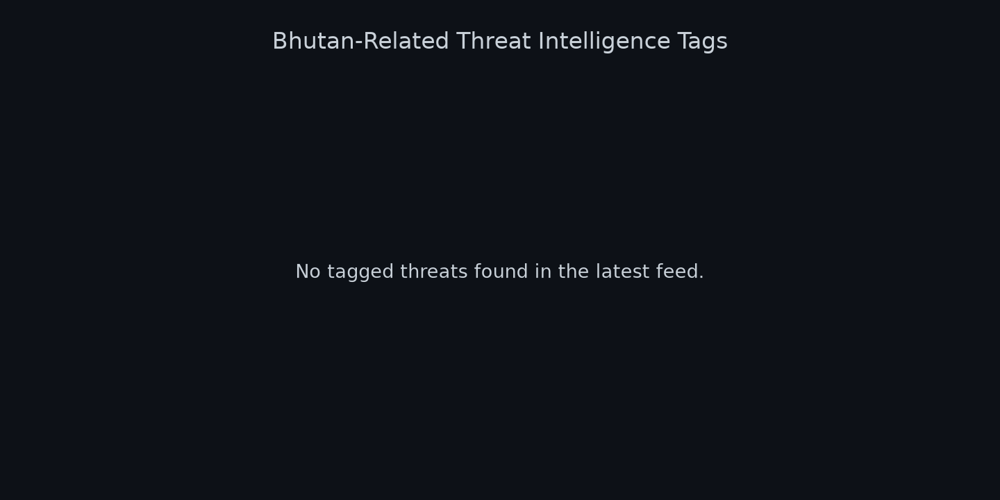

 

 

<a href="#signal">SIGNAL</a> &nbsp;·&nbsp;
<a href="#projects">PROJECTS</a> &nbsp;·&nbsp;
<a href="#threat-feed">THREAT FEED</a> &nbsp;·&nbsp;
<a href="#live-stats">LIVE STATS</a>

---

## `01` / Signal

I’m **Sandip Biswa** (`b1swa25`), a Computer Science & Engineering student focused on digital forensics and cyber security. I learn by building, breaking down problems, and sharing practical projects.

<table>
  <tr>
    <td width="50%" valign="top">
      <strong>EDUCATION</strong>  
      🎓 <strong>B.Tech — Computer Science & Engineering</strong> 
      Digital Forensic and Cyber Security 
      Faridabad, Haryana, India  
      🎓 <strong>Diploma — Computer System & Network</strong> 
      Dewathang, Bhutan
    </td>
    <td width="50%" valign="top">
      <strong>INTERESTS & TOOLBOX</strong>  
      🛡️ Defensive security &nbsp;·&nbsp; 🔎 Threat intelligence 
      🐧 Linux &nbsp;·&nbsp; ⚙️ Systems programming  
      
      
      
      
    </td>
  </tr>
</table>

<strong>More about me</strong>

 

Curious about how threats are discovered and how small, useful tools can make security work clearer. Currently strengthening my programming fundamentals through hands-on projects.

## `02` / Projects

## `03` / Bhutan threat feed

*Updated by a daily GitHub Action when the OTX API secret is configured.*

<strong>Feed details & setup</strong>

 

The workflow queries AlienVault OTX and regenerates this chart. To enable it, add an `OTX_API_KEY` repository secret under **Settings → Secrets and variables → Actions**. The key stays in GitHub Secrets and is never stored in this repository.

## `04` / Live stats

 

 

<picture>
  <source media="(prefers-color-scheme: dark)" srcset="https://raw.githubusercontent.com/b1swa25/b1swa25/output/github-contribution-grid-snake-dark.svg">
  <source media="(prefers-color-scheme: light)" srcset="https://raw.githubusercontent.com/b1swa25/b1swa25/output/github-contribution-grid-snake.svg">
  
</picture>

Faridabad, Haryana, India · with education roots in Dewathang, Bhutan · Thanks for visiting

