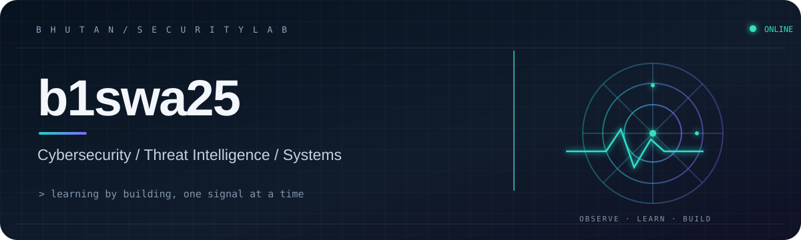

<a href="#about">ABOUT</a> &nbsp;·&nbsp;
<a href="#education">EDUCATION</a> &nbsp;·&nbsp;
<a href="#repositories">REPOSITORIES</a> &nbsp;·&nbsp;
<a href="#activity">ACTIVITY</a>

---

## About

I’m **Sandip Biswa** (`b1swa25`), studying Computer Science & Engineering with a focus on **Digital Forensic and Cyber Security**. I enjoy learning by building practical projects and exploring Linux, systems programming, and defensive security.

## Education

| Program | Focus | Location |
|---|---|---|
| **B.Tech — Computer Science & Engineering** | Digital Forensic and Cyber Security | Faridabad, Haryana, India |
| **Diploma — Computer System & Network** |  | Dewathang, Bhutan |

## Public repositories

All public repositories are listed below. The list refreshes when this profile repository changes and once a day to pick up activity elsewhere.

<!-- REPOSITORIES:START -->

Browse all 13 public repositories

| Repository | Description | Language | Stars | Updated |
|---|---|---|---:|---|
| [CineBharat](https://github.com/b1swa25/CineBharat) | — | C | 0 | 2026-11-15 |
| [PayloadsAllTheThings](https://github.com/b1swa25/PayloadsAllTheThings) | A list of useful payloads and bypass for Web Application Security and Pentest/CTF | — | 0 | 2026-11-09 |
| [b1swa25](https://github.com/b1swa25/b1swa25) | My Cybersecurity Command Center | Python | 0 | 2026-10-02 |
| [Holy\-Bible\-XML\-Format](https://github.com/b1swa25/Holy-Bible-XML-Format) | Holy Bible in 200\+ Languages and 1000\+ versions in XML Format\. | Python | 0 | 2026-07-29 |
| [my\-Jarvis](https://github.com/b1swa25/my-Jarvis) | Personal AI, On Personal Devices | — | 0 | 2026-06-25 |
| [b1swa\_SerConfig](https://github.com/b1swa25/b1swa_SerConfig) | — | Python | 0 | 2026-05-30 |
| [C\-With\-b1swa](https://github.com/b1swa25/C-With-b1swa) | — | C | 0 | 2026-04-26 |
| [Browser\-Exten](https://github.com/b1swa25/Browser-Exten) | — | — | 0 | 2026-04-19 |
| [my\_portfolio](https://github.com/b1swa25/my_portfolio) | Dual\-mode personal portfolio for a security specialist, featuring both a terminal interface and a modern GUI to showcase skills, projects, achievements and contact information in an interactive, cybersecurity\-themed design\. | HTML | 0 | 2026-04-17 |
| [DeepScan\.ai](https://github.com/b1swa25/DeepScan.ai) | — | CSS | 0 | 2026-03-12 |
| [Homoglyph\-analyser](https://github.com/b1swa25/Homoglyph-analyser) | — | HTML | 0 | 2025-11-18 |
| [file\-dump\-search](https://github.com/b1swa25/file-dump-search) | — | HTML | 0 | 2025-11-18 |
| [Infotact\-Solution\-Internship](https://github.com/b1swa25/Infotact-Solution-Internship) | Network Intrusion Detection System \(NIDS\) to monitor and detect malicious activities in a simulated network environment\. The setup uses Kali\-Linux as the attacker machine and Ubuntu Server as the target machine, with SNORT as the core intrusion detection engine | Python | 0 | 2025-10-29 |

<!-- REPOSITORIES:END -->

## Live GitHub activity

These cards read current GitHub data; their images update independently of this README.

 

 

<picture>
  <source media="(prefers-color-scheme: dark)" srcset="https://raw.githubusercontent.com/b1swa25/b1swa25/output/github-contribution-grid-snake-dark.svg">
  <source media="(prefers-color-scheme: light)" srcset="https://raw.githubusercontent.com/b1swa25/b1swa25/output/github-contribution-grid-snake.svg">
  
</picture>

Faridabad, Haryana, India · Thanks for visiting

